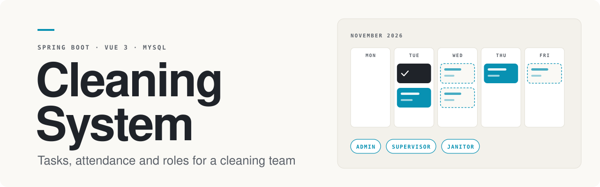
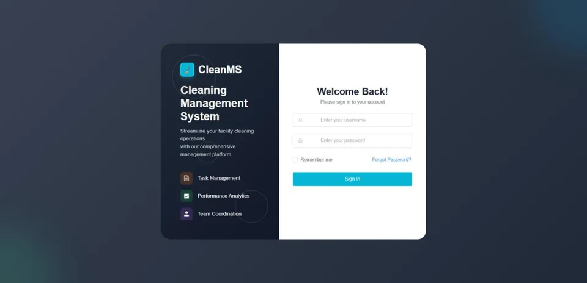
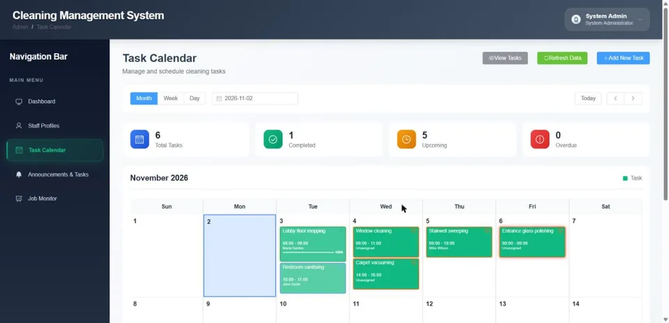
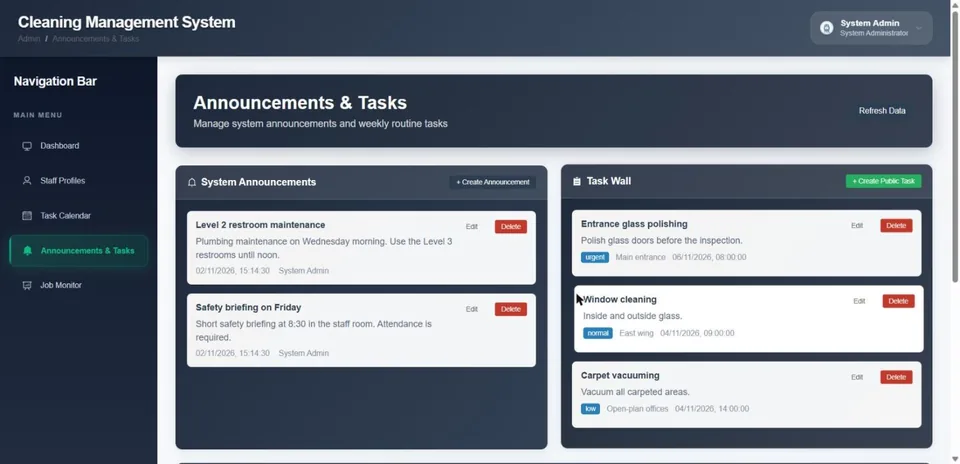
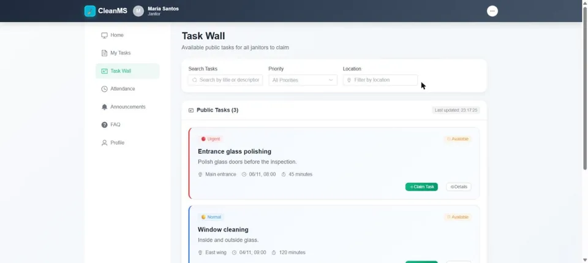
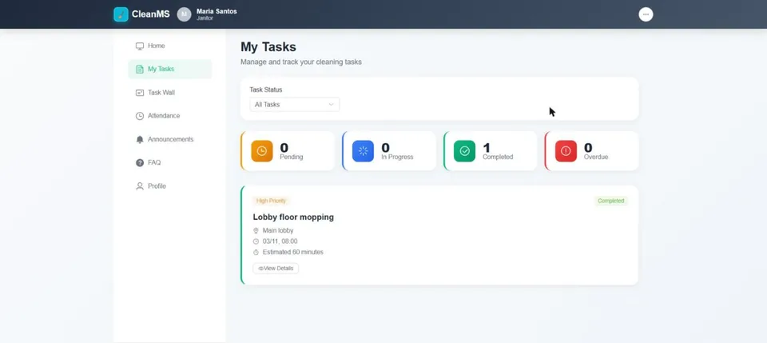
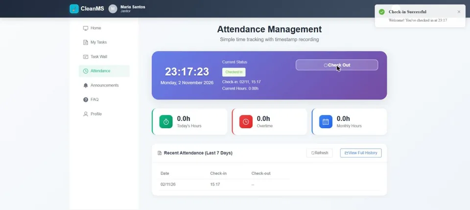
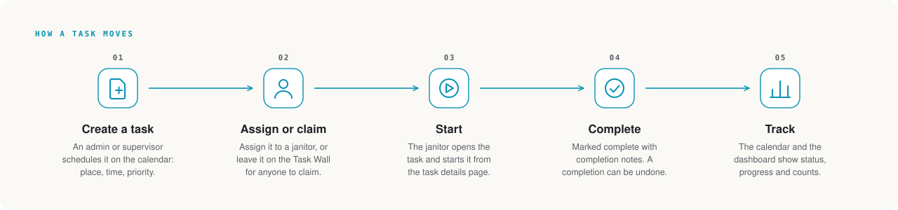
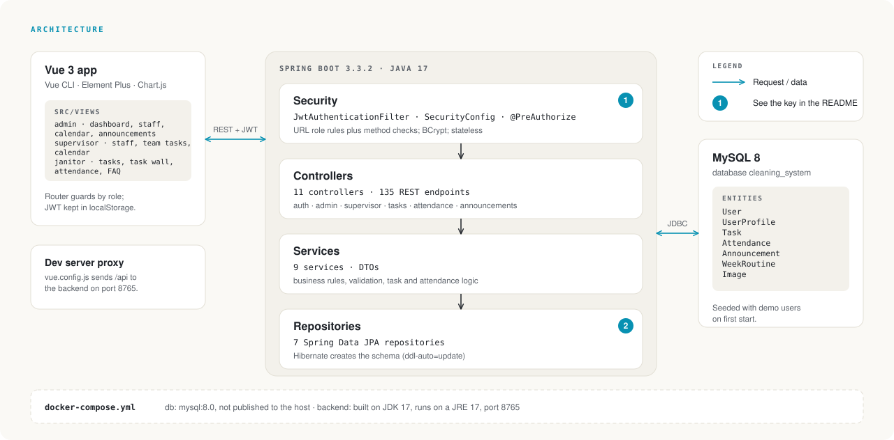

<p align="center">
  
</p>

<p align="center">
  <strong>Cleaning System is a web app for running a cleaning team: admins and supervisors schedule tasks, janitors claim and complete them, and attendance is recorded with check-in and check-out.</strong>
</p>

<p align="center">
  
  
  
  
  
  
</p>

<p align="center">
  <a href="#about">About</a> ·
  <a href="#features">Features</a> ·
  <a href="#how-it-works">How it works</a> ·
  <a href="#architecture">Architecture</a> ·
  <a href="#tech-stack">Tech stack</a> ·
  <a href="#getting-started">Getting started</a> ·
  <a href="#testing">Testing</a> ·
  <a href="#security-and-known-limitations">Security</a>
</p>

## About

Cleaning System (called CleanMS in the interface) is a full-stack web app for coordinating the work of a cleaning
team. It has three roles. **Admins** manage staff, schedule tasks on a calendar and post announcements.
**Supervisors** have their own staff, calendar and team-task pages. **Janitors** see their own tasks, claim open ones
from a shared Task Wall, record their work and check in and out.

It is a Spring Boot REST API with JWT login and role-based access, a Vue 3 single-page app, and a MySQL database.
All the data shown in the screenshots is demo data created for this README; there is no real facility behind it.

## Features

<table>
  <tr>
    <td valign="middle">
      <strong>Sign in by role</strong><br>
      Username and password login. The token carries the role, and each role lands in its own area of the app: admin,
      supervisor or janitor.
    </td>
    <td width="400" align="center"></td>
  </tr>
  <tr>
    <td valign="middle">
      <strong>Task calendar</strong><br>
      Month, week and day views of scheduled tasks, coloured by status, with progress and counters for total,
      completed, upcoming and overdue. Admins create and assign tasks, search them in a filtered list and run batch
      operations on them.
    </td>
    <td width="400" align="center"></td>
  </tr>
  <tr>
    <td valign="middle">
      <strong>Announcements and the Task Wall</strong><br>
      Admins post announcements with a priority, a type and an audience, and publish public tasks to the Task Wall.
      Weekly routines can generate recurring tasks.
    </td>
    <td width="400" align="center"></td>
  </tr>
  <tr>
    <td valign="middle">
      <strong>Task Wall for janitors</strong><br>
      Janitors browse the open public tasks, filter them by priority and location, and claim one.
    </td>
    <td width="400" align="center"></td>
  </tr>
  <tr>
    <td valign="middle">
      <strong>My tasks</strong><br>
      A janitor's own tasks with pending, in-progress, completed and overdue counters. A task is started from its
      detail page, completed with notes, and a completion can be undone.
    </td>
    <td width="400" align="center"></td>
  </tr>
  <tr>
    <td valign="middle">
      <strong>Attendance</strong><br>
      Check in and check out with timestamps, today's hours, overtime and monthly hours, a list of recent attendance
      and a full history page.
    </td>
    <td width="400" align="center"></td>
  </tr>
</table>

Also in the app:

- **Staff profiles.** Admin and supervisor pages for managing staff, and a profile page for janitors.
- **Announcements for janitors,** an FAQ page and a task photo page.
- **Reports.** Report endpoints under `/api/admin/reports`, available to admins only.
- **Image upload.** Endpoints for uploading and fetching images, limited to 5 MB per file.

## How it works

<p align="center">
  
</p>

## Architecture

<p align="center">
  
</p>

### Key

1. **Role rules in two layers.** `SecurityConfig` has URL rules per role, and controller methods add `@PreAuthorize`
   checks. The router guards in the frontend only hide pages; the backend is what enforces access. Actions janitors
   need (start, claim, undo a completion) are open to any signed-in user; deleting, assigning and batch-editing tasks
   needs an admin or a supervisor.
2. **The schema comes from Hibernate.** `ddl-auto=update` creates and changes the tables, so there are no migration
   scripts. Demo users are created on the first start, when the user table is empty.

### Design decisions

- **Stateless API.** Login returns a JWT (valid for one day by default) that the app sends in the `Authorization`
  header; there are no server sessions. Passwords are stored with BCrypt.
- **One app, three areas.** Admin, supervisor and janitor pages live in the same Vue app under separate routes and
  layouts, so shared dialogs and request code are reused.
- **Attendance is timestamp-only.** Check-in and check-out record the time; location checks were dropped.
- **Settings come from the environment.** The database password and the JWT secret have no defaults, and the backend
  refuses to start until they are set.

## Tech stack

Versions are the constraints declared in `pom.xml` and `cleaning-system-frontend/package.json`.

| Layer | Technology |
|---|---|
| Backend | Java 17, Spring Boot 3.3.2, Spring Security, Spring Data JPA (Hibernate), jjwt `0.11.5`, MySQL Connector/J, Maven |
| Frontend | Vue `^3.2.13`, Vue Router `^4.0.3`, Element Plus `^2.10.5`, Chart.js `^4.5.0` with vue-chartjs `^5.3.2`, Axios `^1.11.0`, Vue CLI `~5.0.0` |
| Database | MySQL 8.0 |
| Run | Docker Compose (`mysql:8.0`, built on `maven:3.9-eclipse-temurin-17`, runs on `eclipse-temurin:17-jre`) |

## Project structure

```
cleaning-system-backend/      Spring Boot app (Java 17, Maven) and its Dockerfile
  src/main/java/.../backend/
    config/ security/         security rules, JWT filter, 401 handler
    controller/               11 REST controllers
    service/ repository/      business logic, Spring Data JPA
    entity/ dto/              7 entities, request and response objects
  src/main/resources/         application.properties (reads the environment)
cleaning-system-frontend/     Vue 3 app (Vue CLI)
  src/views/                  admin, supervisor and janitor pages
  src/components/             layouts and shared dialogs
  src/router/                 routes with role guards
docs/API.md                   REST API reference
docker-compose.yml            MySQL and backend
.env.example                  settings you must provide
```

## Getting started

You need Docker with Compose, and Node.js for the frontend (the production build was last checked with Node 24). The
JDK is not needed on your machine; the backend is built inside Docker.

1. **Clone the repository.**

   ```
   git clone https://github.com/teosam89/Cleaning-System.git
   cd Cleaning-System
   ```
2. **Create `.env`.** Copy `.env.example` to `.env` and set `DB_PASSWORD` and `JWT_SECRET` (at least 32 characters;
   `openssl rand -base64 48` makes one). `.env` is git-ignored.
3. **Start the database and the backend.**

   ```
   docker compose up -d --build
   ```

   The API is at `http://localhost:8765`; `GET /api/health` should answer "Service is running normally".
4. **Start the frontend.**

   ```
   cd cleaning-system-frontend
   npm ci
   npm run serve
   ```

   The app is at `http://localhost:3000`. The dev server proxies `/api` to the backend on port 8765.

**Demo accounts** are created on the first start. They are for trying the app only; change or remove them
(`DataInitializer.java`) before any real use.

| Username | Password | Role |
|---|---|---|
| `admin` | `admin123` | admin |
| `supervisor`, `sarah` | `supervisor123`, `sarah123` | supervisor |
| `maria`, `john` | `maria123`, `john123` | janitor |
| `mike` | `mike123` | cleaner |

**Settings** (read from the environment; `docker compose` passes the first three from `.env`):

| Variable | Default | Purpose |
|---|---|---|
| `DB_PASSWORD` | none, required | Password of the MySQL root user |
| `JWT_SECRET` | none, required | Key that signs login tokens, at least 32 characters |
| `CORS_ALLOWED_ORIGINS` | `http://localhost:3000` | Comma-separated browser origins allowed to call the API |
| `JWT_EXPIRATION_MS` | `86400000` (one day) | Token lifetime |
| `DB_URL`, `DB_USERNAME` | local MySQL, `root` | Only needed when running the backend outside Docker |

## Testing

**There are no automated tests.** `pom.xml` declares test dependencies, but `src/test` does not exist.

When this repository was prepared for archiving, the following was checked by hand:

- The production frontend build (`npm run build`) passes.
- The backend starts in Docker on JDK 17, and refuses to start without `DB_PASSWORD` or `JWT_SECRET`.
- With the demo accounts, a janitor is refused on deleting, assigning and batch-editing tasks (`403`) and on the
  admin-only data endpoint (`401`), while starting, claiming and undoing a task still work. Admins and supervisors
  get through to the task endpoints (the checks used task IDs that do not exist, so nothing was changed).
- A browser request from an origin that is not in `CORS_ALLOWED_ORIGINS` is rejected.

## Security and known limitations

- Passwords use BCrypt. Login tokens are signed JWTs with a one-day lifetime by default. No secret is committed:
  `.env` is git-ignored and the backend needs the settings above.
- Access is checked on the server (URL rules plus `@PreAuthorize`), not only in the frontend. Cross-origin calls are
  limited to the configured origins.

This is a coursework project and it is not production-ready. Known limitations:

- No automated tests.
- `GET /api/files/**` is public, so uploaded files can be fetched without signing in.
- The read-only task endpoints (list, search, statistics) are open to any signed-in user; only the endpoints that
  change tasks are role-checked.
- URL-rule denials answer `401`, while `@PreAuthorize` denials answer `403`.
- The login token is kept in `localStorage`.
- Tables are created by Hibernate (`ddl-auto=update`) instead of migrations.
- Times are stored in UTC and some pages show them unconverted: on the attendance page the check-in time can differ
  from the clock by the local UTC offset.
- The admin dashboard's "Recent Activities" shows a placeholder entry ("API Test").
- `POST /api/tasks/{id}/photos` is a stub that returns made-up metadata, and `POST /api/data/generate-attendance` is a
  developer data seeder with hard-coded janitor IDs (it is admin-only now).
- Some files are very large: `AdminController` has about 1,400 lines and several Vue views are over 70 KB.

## Status

A team coursework project. The code was uploaded to this repository by one team member (the author below); the other
contributors could not be found, so the commit history, which runs from October 2025 to May 2026, shows only that
account. The project is finished and **archived**: it is not maintained, and issues and pull requests are not
monitored.

## Author

Teo Boon Shen, [zerofield.dev](https://zerofield.dev)

## License

All rights reserved.
